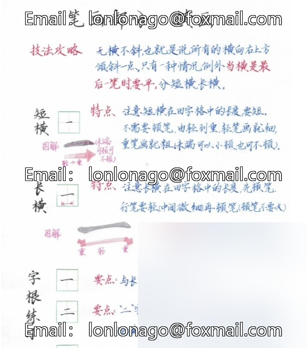
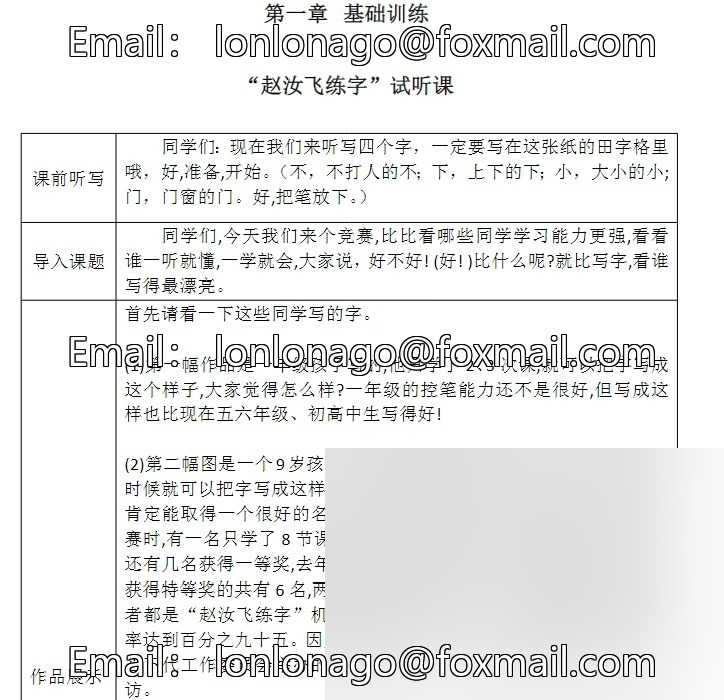
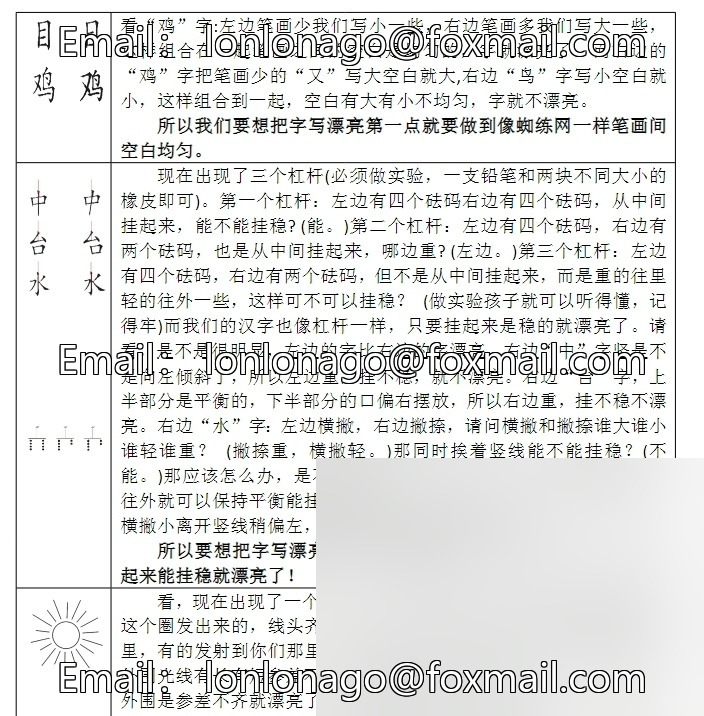
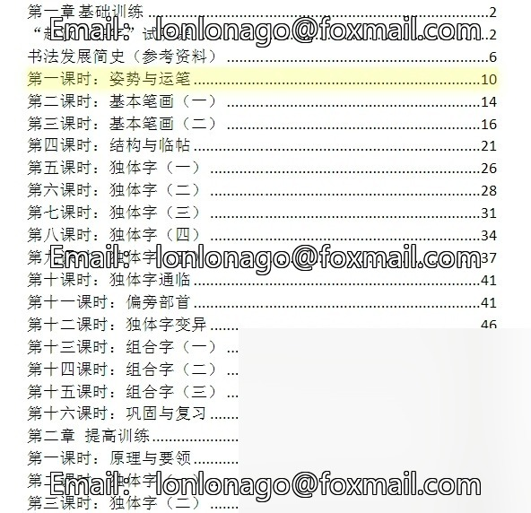

# Hard pen calligraphy teaching plan, consisting of 24 lessons and 105 page document materials.

## Body

Hard pen calligraphy lesson plan, with a total of 24 lessons and 105 page document materials.
It is suitable for teaching and use by calligraphy class teachers.

online trading, and direct ordering allows immediate shipping.
I am online at long-term and will ship immediately.

The handwriting teaching plan covers 24 lessons with 105 pages, including calligraphy tutorials, stroke techniques, training guidance and classroom practice/contests.

<!-- AI_ENRICHED -->

## Images

## Payment

Here is a pay link on Stripe ( https://buy.stripe.com/3cs8yP7sY87d0vu9AB ). Please contact me lonlonago@foxmail.com after funding $89, and I will send you a complete data files , thank you!

